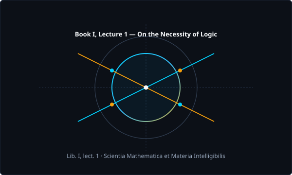

<a href="https://geometor.github.io/aquinas/"></a>

# GEOMETOR • aquinas

**Visit the Online Archive:** https://geometor.github.io/aquinas/

<p align="center">
  <a href="https://geometor.github.io/aquinas/"></a>
</p>

**St. Thomas Aquinas • Super Boetium De Trinitate & Aristotelian Commentaries • semantic digital archive**

## Mission

`geometor/aquinas` is part of the interconnected [GEOMETOR](https://geometor.com) semantic digital archive. It provides a critical multi-track bilingual Book Codex and concordance assembling the foundational writings of St. Thomas Aquinas on mathematical science, intelligible matter, abstraction, and the epistemic certitude of geometry. The archive liberates these thirteenth-century texts from isolated print bounds into addressable semantic units, synchronized Latin-English tracks, primary-source citation provenance, and exact symbolic connections across the GEOMETOR corpus.

## Books in This Archive

- [Commentary on Boethius's On the Trinity (Questions V–VI)](https://geometor.github.io/aquinas/super_boetium_de_trinitate/) — *Expositio super librum Boethii De Trinitate*, treating the division of speculative science, mathematical abstraction (*abstractio formae*), and intelligible matter.
- [Commentary on Aristotle's Posterior Analytics](https://geometor.github.io/aquinas/analytica_posteriora/) — *Expositio libri Posteriorum Analyticorum*, establishing the demonstrative certitude of mathematics and Euclidean principles.
- [Commentary on Aristotle's On the Soul](https://geometor.github.io/aquinas/de_anima/) — *Sentencia libri De anima*, analyzing the phantasm in geometry, continuous extension, and the intellect.
- [Commentaries on Physics and On the Heavens](https://geometor.github.io/aquinas/physica/) — *In octo libros Physicorum & In libros De caelo et mundo*, demonstrating the non-atomism of the continuum and spatial dimensions.
- [Commentary on Aristotle's Metaphysics](https://geometor.github.io/aquinas/metaphysica/) — *Sententia super Metaphysicam*, investigating intelligible matter, actuality, and geometric truth discovered by division in act.
- [Summa Theologiae and Disputed Questions](https://geometor.github.io/aquinas/summa_theologiae/) — *Summa Theologiae, De Potentia, et De Veritate*, systematic syntheses on *ipsum esse*, the geometer's infinite line, and indemonstrable first principles.

## Repository Contents

- `docsrc/` — Multi-track Book Codex, apparatus, and Sphinx documentation compiled by [PHOTON publish](https://github.com/photon-platform/publish).
- `resources/` — Diplomatic Latin sources, Hoenen Thomistic concordance, and apparatus registries (citations, persons, glossary).
- `src/geometor/aquinas/` — Python codex compilation and integrity verification tools.

## Local Build & Verification

```bash
publish build
uv run --no-sync pytest
```
## Part of the GEOMETOR Knowledge Archive

Explore all **74 Book Codices** and **11 Mathematical Catalogs** at https://geometor.com/books/.
