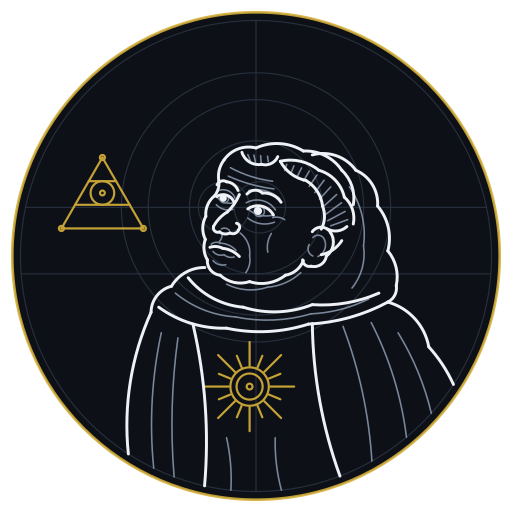

:site_title: St. Thomas Aquinas

.. _aquinas-index:
.. _scientia-mathematica-index:

.. container:: author-overline

   the works of

St. Thomas Aquinas
==================

:person:`St. Thomas Aquinas, O.P. <aquinas>` (1225–1274) forged the classical synthesis between Aristotelian logic and Euclidean geometry, explaining how the mind abstracts mathematical form from sensible change into *intelligible matter* (*materia intelligibilis*) and why every geometric proof terminates in constructive imagination. This bilingual Latin–English archive gathers **37 unabridged lectures and articles** across six major works—paired with an :doc:`introductory Prooemium <prooemium/index>`, critical apparatus from the Leonine, Marietti, and Decker editions, and interactive vector figures.

Books in This Collection
------------------------

.. container:: home-book-hero

   .. container:: home-book-thumb

      .. image:: super_boetium_de_trinitate/art_03/figure.svg
         :alt: Mathematical Abstraction and Intelligible Matter in Aquinas's Commentary on Boethius
         :target: super_boetium_de_trinitate/index.html

   .. container:: home-book-body

      .. rubric:: Treatise I · c. 1257–1259 · 6 Articles · 4 Tracks

      **Commentary on Boethius's On the Trinity (Questions V–VI)** — Aquinas's foundational division of speculative science: distinguishing mathematical *abstractio formae* from metaphysical *separatio*, defining *materia intelligibilis*, and showing why mathematical judgment terminates at the imagination.

      .. container:: home-actions

         * :doc:`Open De Trinitate → <super_boetium_de_trinitate/index>`
         * :doc:`Q. 5, Art. 3 (Abstraction) → <super_boetium_de_trinitate/art_03/index>`
         * :doc:`Q. 6, Art. 2 (Imagination) → <super_boetium_de_trinitate/art_06/index>`

.. container:: home-book-hero

   .. container:: home-book-thumb

      .. image:: analytica_posteriora/lect_01/figure.svg
         :alt: Demonstrative Certitude in Aquinas's Posterior Analytics Commentary
         :target: analytica_posteriora/index.html

   .. container:: home-book-body

      .. rubric:: Treatise II · c. 1270–1272 · 11 Lectures · 4 Tracks

      **Commentary on Aristotle's Posterior Analytics** — An exposition of mathematical demonstration (*apodeixis*): why mathematics holds the highest place in demonstrative certitude, how common conceptions relate to postulates, and how universal principles arise from sense and intellect.

      .. container:: home-actions

         * :doc:`Open Posterior Analytics → <analytica_posteriora/index>`
         * :doc:`Book I, Lect. 1 → <analytica_posteriora/lect_01/index>`

.. container:: home-book-hero

   .. container:: home-book-thumb

      .. image:: metaphysica/lect_05/figure.svg
         :alt: Discovering Geometric Truth by Dividing Figures in Act (Metaphysics IX)
         :target: metaphysica/index.html

   .. container:: home-book-body

      .. rubric:: Treatise V · c. 1270–1272 · 5 Lectures · 4 Tracks

      **Commentary on Aristotle's Metaphysics** — Individual versus common intelligible matter, mathematical intermediates, and the landmark analysis of geometric discovery: geometers bring hidden truths to light by dividing figures in act (Euclid I.32 and III.31).

      .. container:: home-actions

         * :doc:`Open Metaphysics → <metaphysica/index>`
         * :doc:`Book IX, Lect. 10 (Euclid I.32 & III.31) → <metaphysica/lect_05/index>`

.. container:: home-feature-grid

   .. container:: home-feature-card

      **On the Soul (5 Lectures, c. 1267–1268)**

      Why human understanding turns continually to phantasms (*conversio ad phantasmata*), spatial continuum versus physical body, and the hand as organ of organs.

      .. container:: home-actions

         * :doc:`Open De Anima → <de_anima/index>`

   .. container:: home-feature-card

      **Physics & On the Heavens (6 Lectures, c. 1268–1273)**

      Why mathematical abstraction involves no falsehood (*abstrahentium non est mendacium*), immobile place, and why a continuum cannot be composed of indivisible points.

      .. container:: home-actions

         * :doc:`Open Physics & Heavens → <physica/index>`

   .. container:: home-feature-card

      **Summa Theologiae & Disputed Questions (4 Articles)**

      *Ipsum Esse*, the geometer's infinite line, turning to phantasms in the *Summa*, and the origin of indemonstrable first principles in *De Potentia* and *De Veritate*.

      .. container:: home-actions

         * :doc:`Open Summa Theologiae → <summa_theologiae/index>`

Key Features
------------

.. container:: home-feature-grid

   .. container:: home-feature-card

      **Critical Latin & Synchronized Tracks**

      Every section aligns the critical Latin text (Leonine, Decker, and Marietti editions) with a faithful English translation, structural summary, and noetic-geometric commentary.

   .. container:: home-feature-card

      **78-Locus Hoenen Concordance**

      The :doc:`Master Concordance <concordance>` maps 100% of the Thomistic citation keys in Peter Hoenen S.J.'s *De Noetica Geometriae* (1954) to Aristotle, Euclid, and GEOMETOR.

   .. container:: home-feature-card

      **Geometric Noetics Apparatus**

      Begin with the :doc:`Prooemium <prooemium/index>`, browse 36 foundational scholastic concepts in the :doc:`Technical Glossary <glossary>`, or trace 113 sources in the :doc:`Bibliography <bibliography>`.

Reference & Project
-------------------

.. container:: home-columns

   .. container:: home-col

      .. rubric:: Scholarly Apparatus

      * :doc:`Introduction (Prooemium) <prooemium/index>` — Aquinas's philosophy of mathematical science
      * :doc:`Master Concordance <concordance>` — 78-locus Hoenen–Aquinas–Aristotle–Euclid matrix
      * :doc:`Technical Glossary <glossary>`, :doc:`People <people/index>`, & :doc:`Bibliography <bibliography>` — 36 scholastic terms and 113 cited editions

   .. container:: home-col

      .. rubric:: About This Project

      * :doc:`About <about/index>` — Scope, Leonine/Marietti witnesses, and Thomistic noetics
      * :doc:`Using This Edition <usage/index>` — Navigation guide and track-switching controls
      * :doc:`Log <log/index>`, :doc:`Changelog <changelog>`, :doc:`Modules <modules/index>`, & :doc:`Connect <connect>` — Development notes, Python tools, and community links

.. toctree::
   :hidden:
   :maxdepth: 2

   super_boetium_de_trinitate/index
   analytica_posteriora/index
   de_anima/index
   physica/index
   metaphysica/index
   summa_theologiae/index
   prooemium/index
   concordance
   bibliography
   people/index
   glossary
   usage/index
   about/index
   log/index
   modules/index
